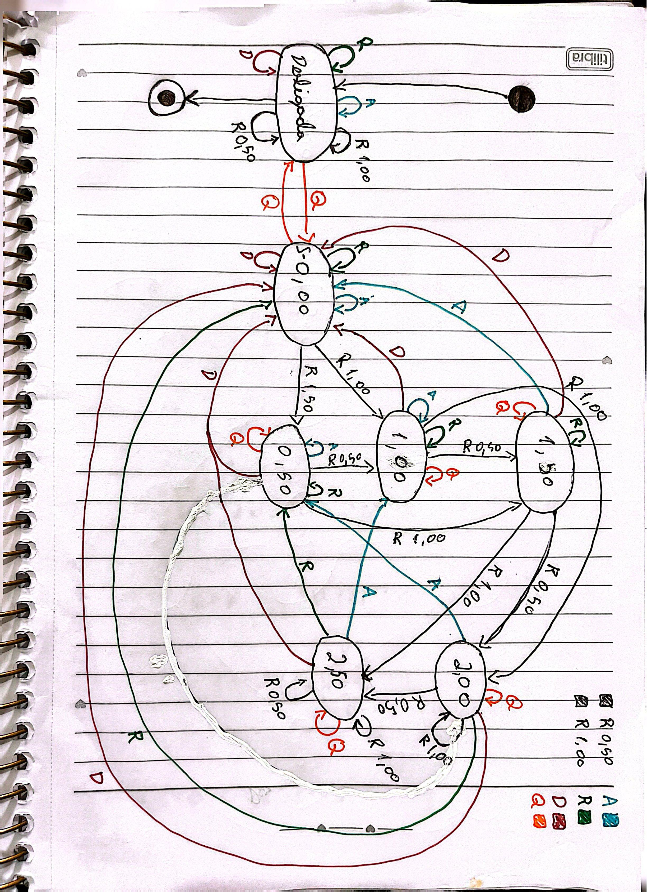

# Trabalho 4 – Software para uma Máquina de Vender Bebidas

## 1. Descrição do projeto

Este projeto consiste no desenvolvimento de um programa em C++ que simula o funcionamento de uma máquina de venda de bebidas.

O programa permite inserir moedas, consultar o saldo, comprar água ou refrigerante, solicitar a devolução do saldo restante e desligar a máquina.

O objetivo do trabalho é aplicar os conceitos de programação estudados na disciplina de Programação 1, utilizando funções, estruturas condicionais, estruturas de repetição e variáveis.

## 2. Funcionalidades

O programa possui as seguintes funcionalidades:

- Inicialização e desligamento da máquina;
- Inserção de moedas de R$ 0,50 e R$ 1,00;
- Limite máximo de saldo de R$ 2,50;
- Compra de água por R$ 1,50;
- Compra de refrigerante por R$ 2,00;
- Verificação de saldo suficiente para realizar compras;
- Devolução do saldo restante ao cliente;
- Contabilização das bebidas vendidas;
- Exibição do total acumulado pela máquina;
- Identificação de comandos inválidos.

## 3. Tecnologias utilizadas

- Linguagem de programação C++;
- Biblioteca `iostream`, para entrada e saída de dados;
- Biblioteca `string`, para manipulação de textos;
- Git e GitHub, para versionamento e disponibilização do código.

## 4. Como compilar e executar

### Requisitos

- Linux ou ambiente Linux acessível pelo terminal, como o Git Bash com um compilador configurado ou o WSL.
- Compilador C++ `g++`.
- Arquivo-fonte `maq_refri.cpp`.

### Verificar a instalação do compilador

No terminal, execute:

```bash
g++ --version
```

Se o compilador estiver instalado, será exibida a versão disponível.

### Compilar o programa

Entre na pasta onde está localizado o arquivo `maq_refri.cpp` e execute:

```bash
g++ -Wall -Wextra -std=c++17 maq_refri.cpp -o maq_refri
```

Para executar:

```bash
./maq_refri
```

As opções `-Wall` e `-Wextra` habilitam avisos adicionais do compilador, ajudando a identificar possíveis problemas no código. A opção `-std=c++17` seleciona o padrão C++17.

O comando `-o maq_refri` define o nome do arquivo executável gerado após a compilação.

## 5. Organização do código

O programa foi organizado em três partes principais:

- **Função `validarBotao`:** verifica se o comando informado pelo usuário é válido.
- **Função `inserirMoeda`:** realiza a inserção das moedas, atualiza o saldo e verifica o limite máximo permitido.
- **Função `main`:** controla o funcionamento da máquina, as compras, as devoluções e o desligamento.

Os valores monetários são armazenados em centavos, utilizando variáveis do tipo `int`. Essa escolha facilita as operações matemáticas e evita problemas relacionados à representação de valores decimais.

## 6. Diagrama de estados

O diagrama abaixo representa os estados da máquina e suas transições.



## 7. Dificuldades encontradas e aprendizados

Durante o desenvolvimento do projeto, foi necessário compreender melhor como utilizar funções, parâmetros por referência e estruturas condicionais e de repetição.

Uma das dificuldades foi controlar corretamente o saldo do cliente e o total de moedas armazenadas pela máquina, garantindo que os valores fossem atualizados de acordo com cada operação.

O trabalho também contribuiu para a compreensão da importância da validação de entradas e da organização do código em funções.

## 8. Limitações conhecidas

O programa funciona por meio de comandos digitados no terminal e não possui interface gráfica.

A inicialização da máquina depende da entrada do comando `Q` no início da execução. Caso outro comando seja informado inicialmente, o programa exibe uma mensagem de erro e encerra a execução.

## 9. Integrantes e contribuições

| Integrante | Contribuição |
|---|---|
|Maria Laura Barbosa da Silva | Fez o trabalho completo |


**Percentual de contribuição:**

- Maria Laura: 100%

Os percentuais devem representar a contribuição efetiva de cada integrante e totalizar 100%.
